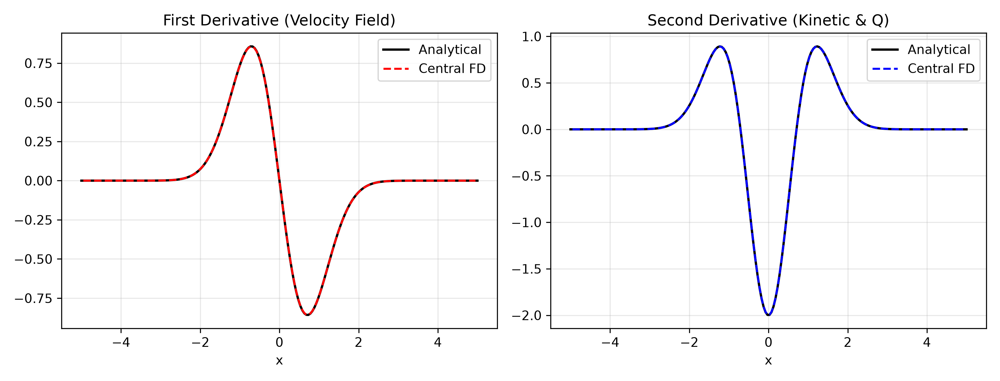
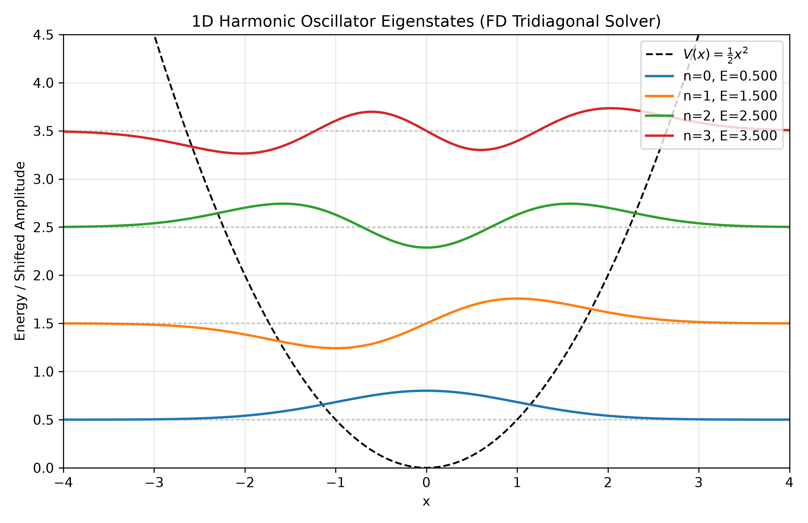
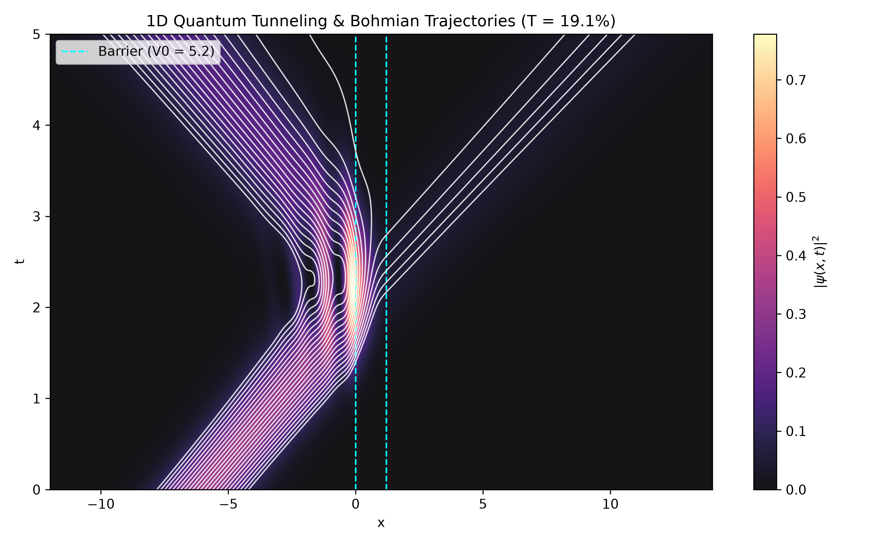

# Numerical Simulations in Quantum & Bohmian Mechanics

This repository contains my numerical implementations of fundamental quantum mechanical equations and **de Broglie–Bohm pilot-wave trajectories** in Python (`NumPy`, `SciPy`, `Matplotlib`). Developed as part of my independent study in theoretical physics and computational methods.

## Repository Structure

* `01_finite_differences.py` — Spatial discretization & central finite difference validation
* `02_tise_harmonic_oscillator.py` — 1D Time-Independent Schrödinger Equation via tridiagonal solver
* `03_bohmian_tunneling.py` — Crank-Nicolson TDSE & Bohmian trajectories across a barrier
* `figures/` — Output plots from simulations
* `requirements.txt` — Python dependencies

---

## Modules Overview

### 1. Spatial Discretization & Finite Differences (`01_finite_differences.py`)
* Implements second-order central finite difference operators for first ($\partial_x$) and second ($\partial_x^2$) spatial derivatives using vectorized NumPy slicing.
* Benchmarks numerical derivatives against analytical solutions for a Gaussian wave packet $f(x) = e^{-x^2}$ to verify interior truncation error, which scales as $\mathcal{O}(\Delta x^2)$.



### 2. Time-Independent Schrödinger Equation (`02_tise_harmonic_oscillator.py`)
* Discretizes the 1D stationary Hamiltonian $\hat{H} = -\frac{\hbar^2}{2m}\frac{d^2}{dx^2} + \frac{1}{2}m\omega^2 x^2$ into a sparse symmetric tridiagonal matrix.
* Computes the lowest four energy eigenvalues and normalized eigenstates using `scipy.linalg.eigh_tridiagonal`, recovering the exact spectrum $E_n = \hbar\omega(n + \frac{1}{2})$.



### 3. Quantum Tunneling & Bohmian Trajectories (`03_bohmian_tunneling.py`)
* Evolves a Gaussian wave packet incident on a rectangular potential barrier ($V_0 = 5.2 > E_{\text{kin}} = 4.5$) using the unconditionally stable, unitary **Crank–Nicolson** scheme (`scipy.linalg.solve_banded`).
* Integrates the **Bohmian guiding equation** simultaneously at each time step:

$$\frac{dx(t)}{dt} = v(x,t) = \frac{\hbar}{m} \text{Im}\left(\frac{\partial_x \psi(x,t)}{\psi(x,t)}\right)$$

* Visualizes probability density evolution $|\psi(x,t)|^2$ alongside non-crossing deterministic particle trajectories, demonstrating trajectory bifurcation at the barrier ($T \approx 19.1\%$).



---

## Usage

```bash
pip install -r requirements.txt
python 03_bohmian_tunneling.py
